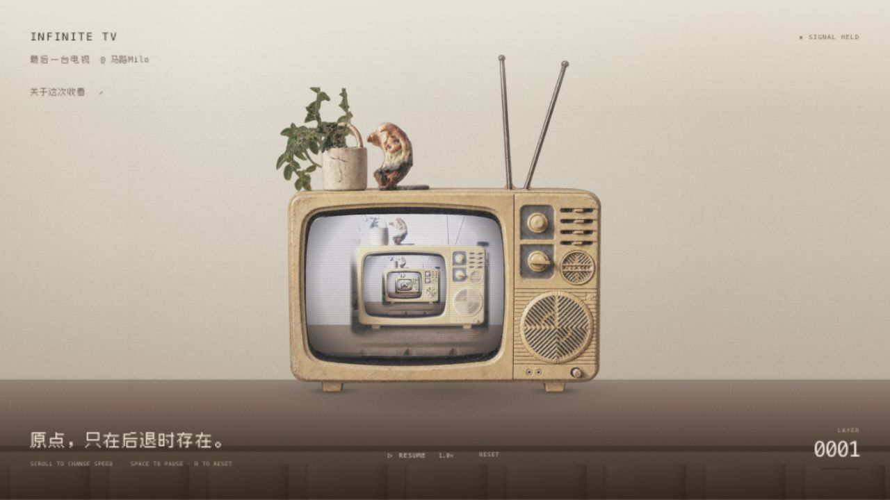

# INFINITE TV / 最后一台电视

原点，只在后退时存在。

由 [马路Milo](https://www.kanshao2077.cn/) 创作的交互式生成艺术作品。



一台电视播放着它所在的房间。每次进入屏幕，房间都会再次出现，原点始终向后退去。千禧年作为一个尚未完成的未来，留在天线、荧光与反复显影的画面里。

Vite + TypeScript + Canvas 2D，运行时零第三方 JavaScript 依赖。首屏有轻微雨丝、褪色机壳和纸质墙面；镜头进入后，雨逐渐淡出，屏幕继续重现同一间客厅。浏览器运行不需要视频、AI 模型、外部 API 或字体服务。

左上角的「@ 马路Milo」可打开作者网站。「关于这次收看」打开中英双语说明《原点的缺席》，阅读时暂停，点击右上角「+」返回原来的播放状态。完整说明见 [CURATORIAL.md](CURATORIAL.md)。

## 运行

需要 **Node.js 22.12+（22 系列）或 Node.js 24+**，推荐 Node.js 24。先进入本文件所在的项目目录：

```bash
npm install
npm run dev
```

打开终端显示的 Local 地址，默认是 `http://localhost:5173/`。开发服务监听局域网地址；手机与电脑连接同一 Wi-Fi 后，也可打开终端显示的 Network 地址。

```bash
npm test          # Node 内置测试，无额外测试框架
npm run check    # TypeScript 类型检查
npm run build    # 类型检查 + 生产构建，产物在 dist/
npm run preview  # 本地预览生产构建，默认端口 4173
```

源码 ZIP 不包含 `node_modules`。随包附带锁文件和已构建的 `dist/`；修改源码后请重新构建。生产文件需要通过 HTTP 服务访问。

## 操作

| 操作 | 结果 |
| --- | --- |
| 滚轮向上 / 触控板向上滚动 | 加速 |
| 滚轮向下 / 触控板向下滚动 | 减速 |
| 手指或鼠标向上拖动 | 加速 |
| 手指或鼠标向下拖动 | 减速 |
| 点击画布 / 轻触画面 / 空格 | 暂停或继续 |
| R / RESET 按钮 | 回到第一层，恢复默认速度并继续 |

默认约 15 秒进入下一层，速度范围为默认速度的 0.1–4 倍，始终向内。速度在约 0.2 秒内平滑过渡。滑动距离超过 8 CSS 像素后，抬手不会触发暂停。

暂停冻结推进、雨丝、噪点、波形和信号异常；恢复时不补跑暂停期间的时间。切换到后台会停止请求动画帧，返回后从原位置继续。系统开启“减少动态效果”时，初次打开保持暂停，可手动播放。按钮可通过 Tab 聚焦；焦点位于按钮时，空格执行该按钮的原生操作。

## 为什么缩放不需要循环复位

每台电视使用相同的屏幕中心坐标系，下一台电视缩小到 `r = 0.42`。相机深度 `depth` 连续增加，绝对编号 `i` 的电视投影为：

```ts
scale = baseScale * Math.pow(0.42, i - depth)
```

这里没有将相机进度取模。跨越整数层时，相同编号的电视继续沿原来的曲线放大；变化的是界面的层数读数。

渲染器只画实际可见的层。超大祖先层的边框完全离开视口后，屏幕效果逐渐归零，再移除该层。判断使用弧形玻璃内的保守矩形，而非“进入下一层就删除上一层”。深处小于半个像素的电视退出绘制，之前有平滑透明度过渡。

每帧从固定的本地素材和几何重新绘制，不把上一帧不断放大。因此不会累积历史帧的模糊，也没有随层数增长的电视列表、DOM 或渲染目标。窗口改变尺寸时重新适配构图，保留相机深度。

## 代码结构

```text
src/
  assets/
    memory-room.png        原始实拍照片，递归内部保持这张底片
    television-foreground-aged.png  首屏透明前景，叶缘补全和机壳做旧
    diary-window.png       用户提供的日记窗口模板与纸张材质
    fonts/                 本地 Fusion Pixel 字体及 OFL 许可证
  core/
    engine.ts              时间、速度平滑及其精确积分、暂停、重置
    geometry.ts            递归比例、投影、视口及可见层裁剪
    math.ts                平滑函数和无状态种子
  render/
    paths.ts               屏幕中心坐标系中的玻璃与机壳路径
    television.ts          保留的程序化电视，照片加载失败时作为回退
    room-scene.ts          首屏前景、接触阴影、纸质墙面与内部共享底片
    canvas-renderer.ts     嵌套裁剪、绘制顺序、资源生命周期
  effects/
    signal.ts              信号图像、年代、扫描线、栅格、噪点和异常
    rain.ts                首屏稀疏轻雨，随相机推进淡出并服从暂停
  input/
    controls.ts            滚轮、Pointer Events、点击和键盘
  ui/
    curatorial.ts          策展说明、焦点、阅读时暂停与关闭后恢复
  types.ts                 核心状态与渲染器接口
  main.ts                  单一帧循环、生命周期和 DOM 状态
  style.css                画面外的排版与响应式布局
tests/
  continuity.test.mjs
  signal.test.mjs
```

`FrameState` 是核心与渲染器之间的数据接口。渲染器提供 `render(state)`、`resize(viewport)`、`dispose()`；输入只发出命令，不在事件回调中运行第二套动画。

下一步替换 Three.js 时，可实现同一个 `ArtworkRenderer` 接口，保留动画核心、层编号、可见层计算和输入控制。GPU 的纹理、材质与渲染目标应由新渲染器统一持有、复用和释放；CRT 效果应限定在屏幕内容，DOM 文字保持独立。

## 视觉与性能边界

- 新视觉采用参考照片中的奶黄机壳、粉灰墙面、暖棕木柜与冷蓝玻璃反光，保留原始实拍的发软颗粒。黑底骨白机壳属于前一版视觉。
- 首屏的电视、天线、花盆与摆件使用透明前景，制作阶段通过图像编辑补全了原图截断的叶缘、加入机壳擦痕与暗沉。原始照片继续用于后面的递归层；这些层的图像不替换。墙面和木柜在 Canvas 内延展，首屏纸质纹理由日记模板的空白纸面取样。素材来源、编辑提示词与许可证见 [ASSETS.md](ASSETS.md)。
- 玻璃使用与照片匹配的贝塞尔遮罩、边缘衰减和高光，屏幕内重画下一层客厅；没有声称进行物理曲面光线追踪。
- 扫描线、荧光栅格和色差是轻量 Canvas 近似，不是对参考 Shader 的完整移植。较小的屏幕平滑减弱细节，避免强烈摩尔纹。
- 轻雨仅作用于首层，使用固定种子和共享动画时间；全程最多 24 条，不逐帧创建对象或定时器。每条雨丝在视口外循环并淡入淡出，相机深度 0.10–0.95 之间平滑退场。
- 信号异常间隔为 20–40 秒，持续 120–200 毫秒。使用平滑包络和小于一个 CSS 像素的局部偏移，不清空屏幕，不改变相机深度。
- 主画布 DPR 上限为 2，总像素预算约六百万；超大视口可能使用小于 1 的有效 DPR。缩放与 Retina 清晰度在这个预算内折中。
- 只有一个 DOM Canvas、六个固定离屏 Canvas（三个信号图案、共享照片、场景颗粒、纸面材质）。图像加载、照片羽化和颗粒位图只初始化一次，没有逐帧全屏 `getImageData` / `putImageData`，缓存不随层数增长。
- 无需 OffscreenCanvas 或 `CanvasRenderingContext2D.filter`，减少移动 Safari 的兼容性差异。
- 画面使用轻度去饱和、降低反差和提亮暗部：`saturate(.74) contrast(.94) brightness(1.025)`。保留原始渲染分辨率，没有柔焦或降采样。文字不受调色影响。
- 策展说明直接使用提供的日记模板，通过九宫格边框保留顶部工具栏与底部图案的比例；正文区域独立滚动，右上角「+」始终可点。Escape、背景点击和左上角红色圆点也可关闭。其余模板工具图案作为装饰。

## 可调入口

| 参数 | 位置 | 默认值 |
| --- | --- | --- |
| 每层时长 | `core/engine.ts` 的 `SECONDS_PER_LAYER` | 15 秒 |
| 速度过渡 | `core/engine.ts` 的 `SPEED_RESPONSE_SECONDS` | 0.2 秒 |
| 递归比例 | `core/geometry.ts` 的 `RECURSION_RATIO` | 0.42 |
| 像素预算与构图尺寸 | `core/geometry.ts` | 六百万像素、机壳最大宽度约 720 CSS px |
| 噪点、扫描线、荧光与年代 | `effects/signal.ts` | 低强度、按尺寸退场 |
| 实拍场景与延展 | `render/room-scene.ts`、`assets/memory-room.png` | 奶黄 CRT 与千禧年家庭客厅 |
| 首屏雨量、速度与退场 | `effects/rain.ts` | 稀疏轻雨，进入下一层前淡出 |
| 作品概念文案 | `index.html`、`CURATORIAL.md` | 《原点的缺席》，中英双语 |
| 整体褪色程度 | `style.css` 的 `#scene` | 饱和度 0.74、反差 0.94、亮度 1.025 |
| 首屏纸质纹理 | `render/room-scene.ts` | 仅绝对层 0，混合透明度 0.56 |

调整递归比例或玻璃形状后，应重新确认子电视完整落在父级玻璃内，并更新保守裁剪矩形与接缝验收。

## 可复现画面检查

仅开发模式支持固定画面参数，生产构建会忽略它们：

```text
/?still=1&frameDepth=0&frameTime=8
/?still=1&frameDepth=0.99999&frameTime=8
/?still=1&frameDepth=1.00001&frameTime=8
/?still=1&frameDepth=1000000&frameTime=8
```

固定 `frameTime` 可以隔离噪点和波形变化，检查整数层与祖先裁剪边界。开发模式的 Canvas `data-*` 属性提供当前深度、信号时间、速度、可见层数和滚动性能采样，生产模式不输出这些诊断。

检查真实设备帧率时，应结合浏览器性能面板和设备显示刷新率；内置浏览器的离屏 RAF 速率不代表真实屏幕呈现帧率。实际执行结果见 [VALIDATION.md](VALIDATION.md)，参考取舍见 [REFERENCES.md](REFERENCES.md)。

## 代码托管与自动检查

GitHub：[kanshao2077/infinite-tv](https://github.com/kanshao2077/infinite-tv)。提交到 `main` 或创建 Pull Request 时，GitHub Actions 使用 Node.js 24 安装锁定依赖、执行测试并构建。第三方 Action 固定到提交 SHA，工作流只申请读取仓库的权限。

仓库公开源码与作品预览。图像和字体的来源、制作过程及授权分别见 [ASSETS.md](ASSETS.md)，不要将代码托管理解为对全部视觉素材授予新的开放许可证。

本项目当前不包含线上托管配置；`npm run preview` 是本地生产预览。Vite 以相对资源路径构建，便于后续部署到子目录。
